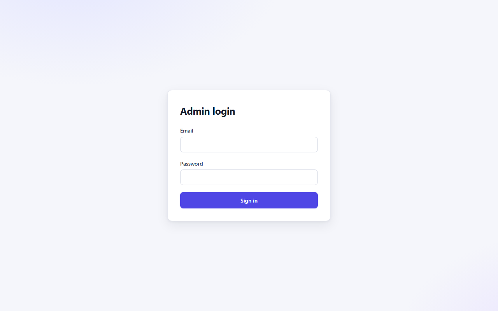
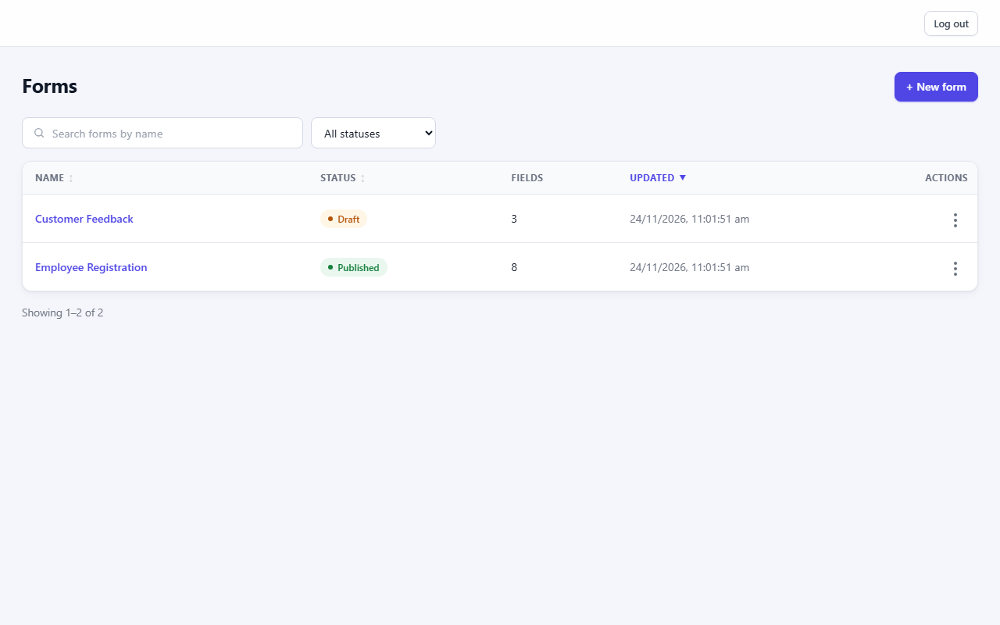
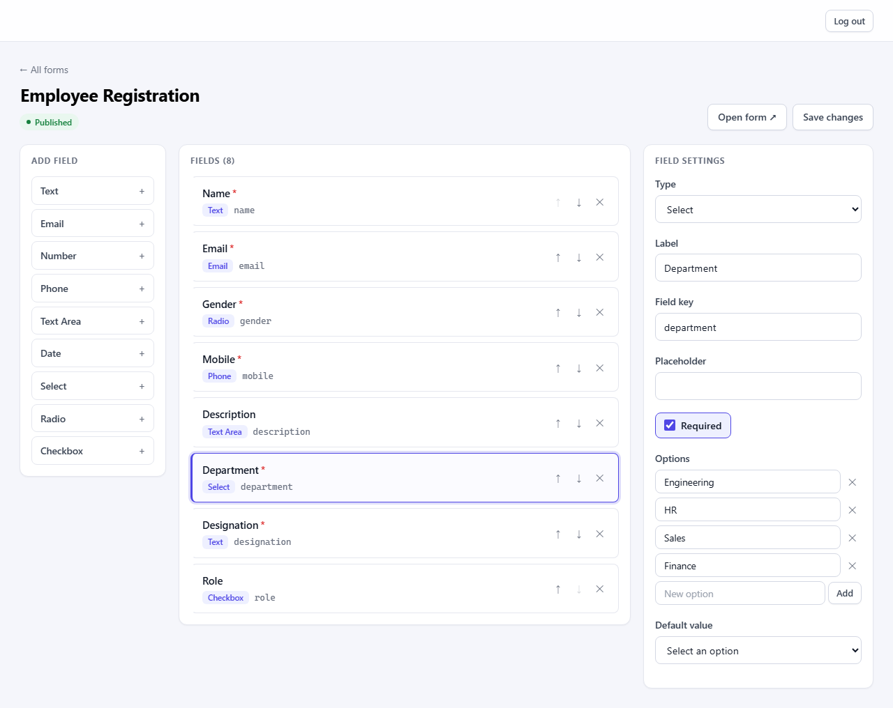
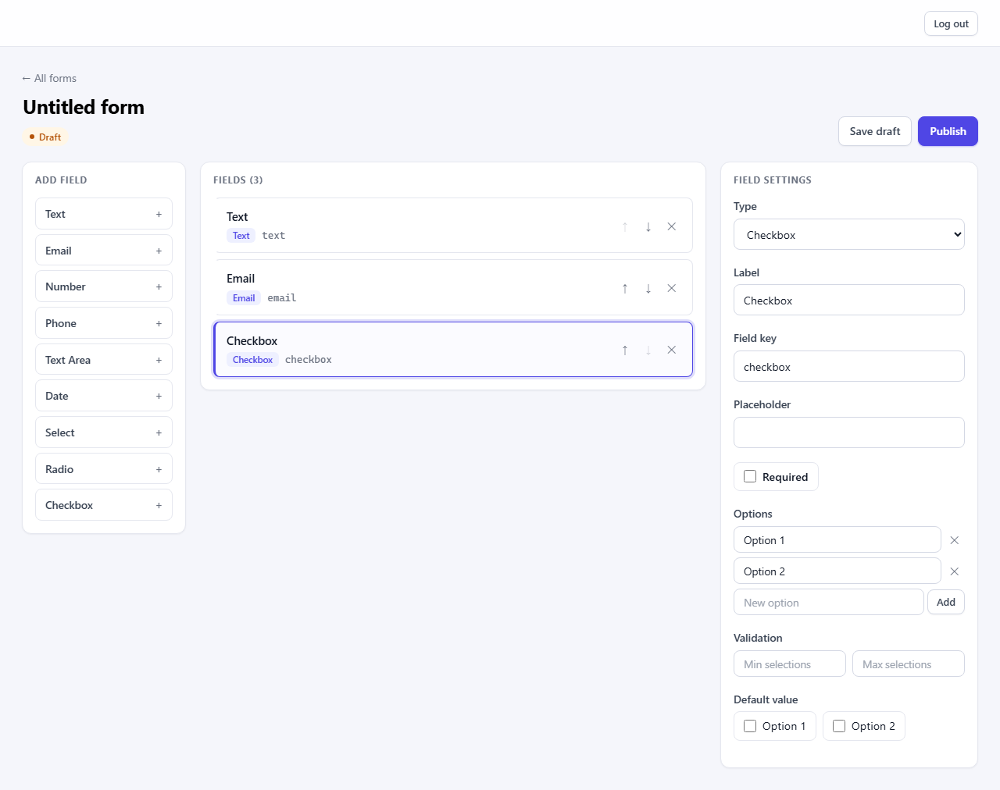
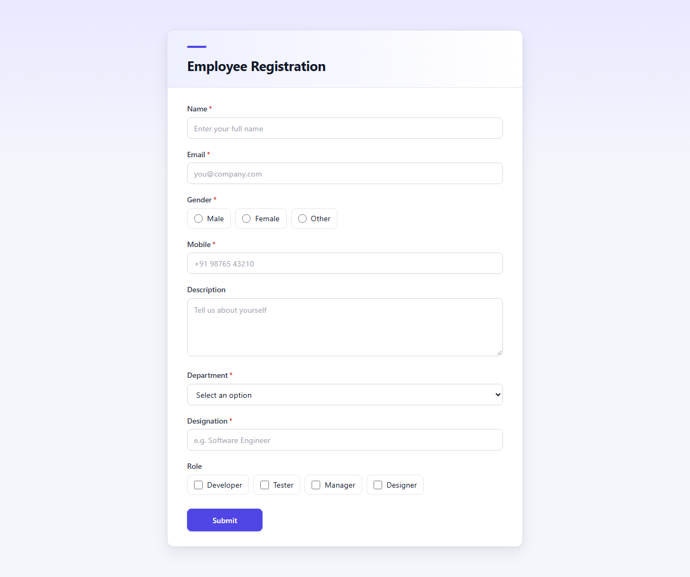
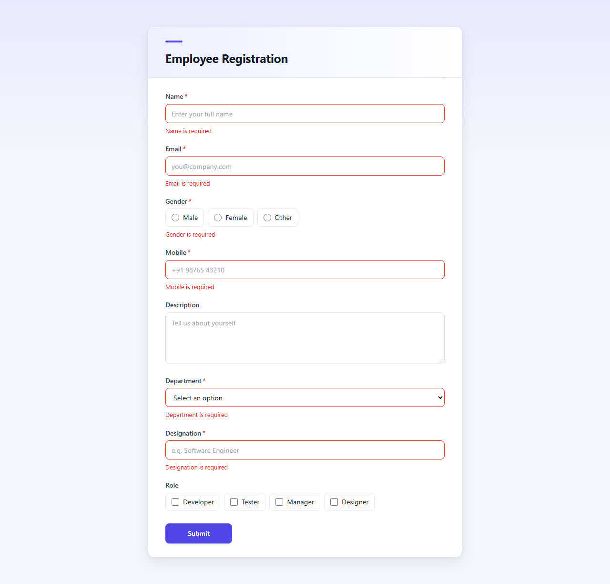
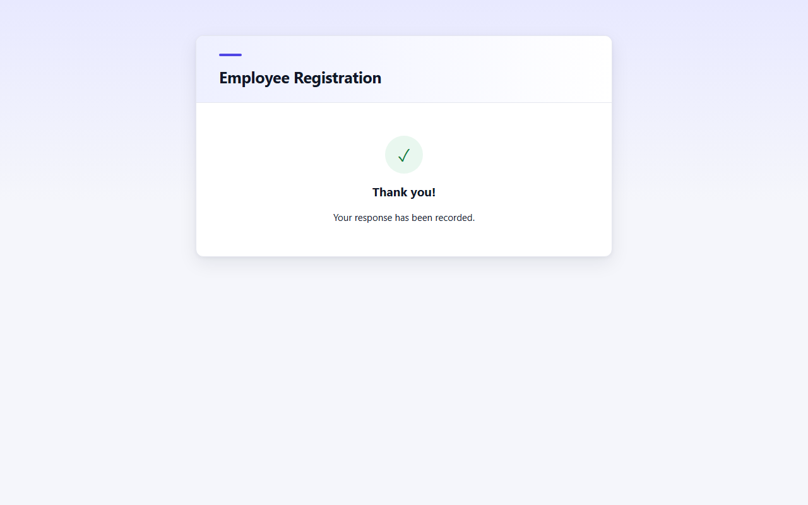
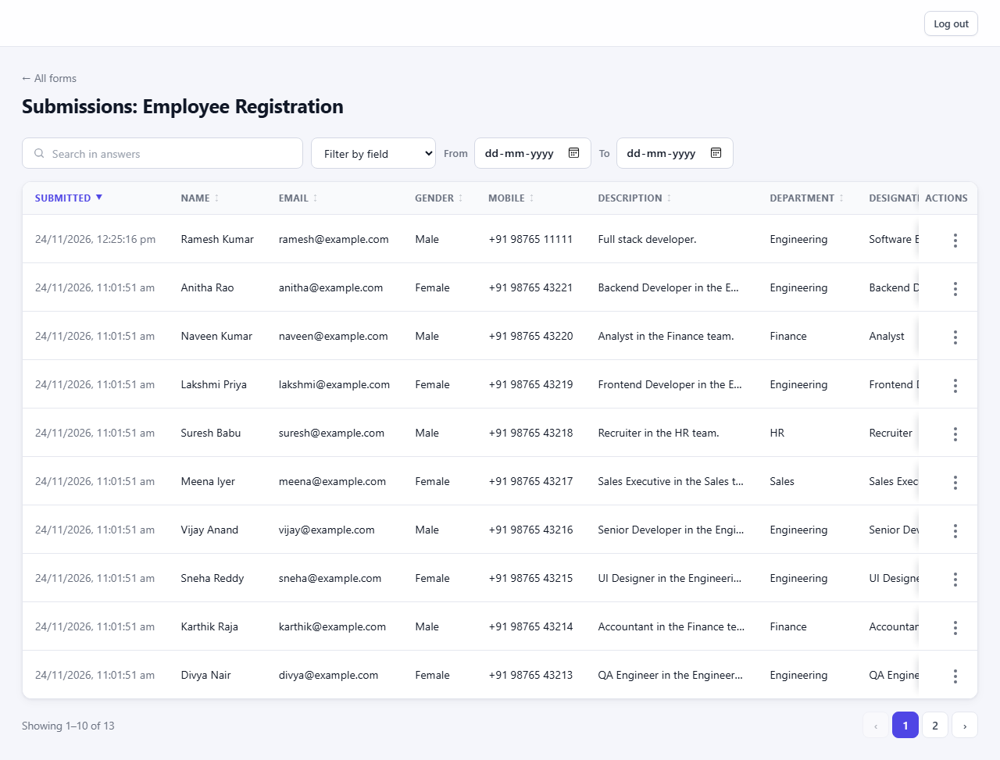
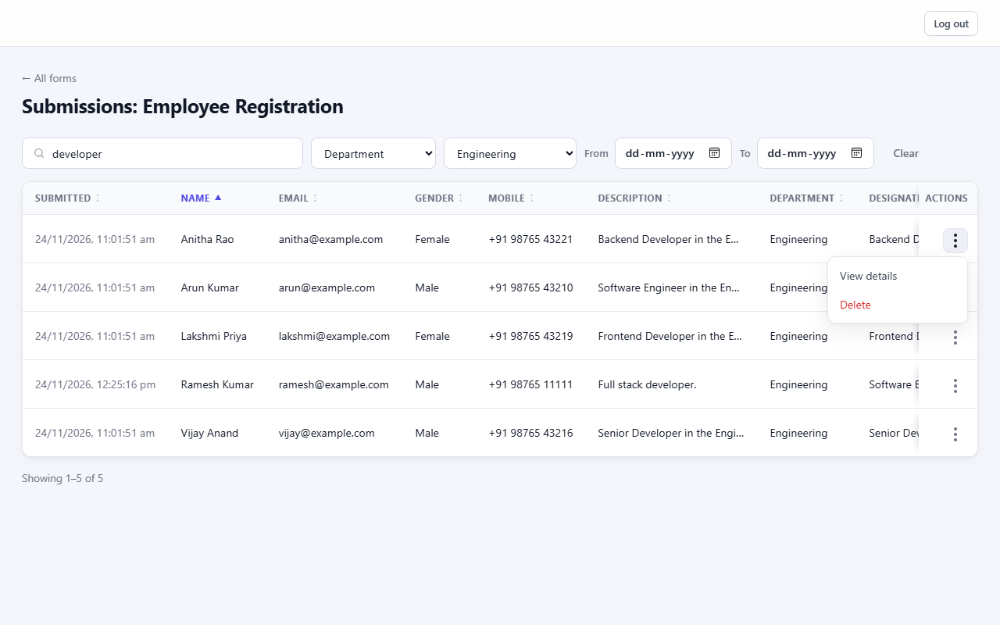
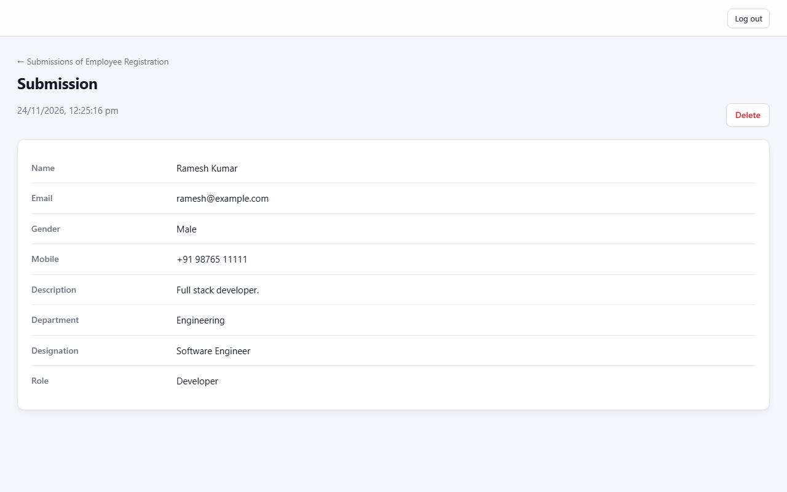

# Dynamic Form

Admin creates forms with dynamic fields, saves them as draft and publishes them. Users open `/forms/:formId`, fill the form and submit. The backend checks every submission against the saved form before storing it.

Tech: React, Redux Toolkit, Node.js, Express, MongoDB

## Screenshots

Login



Forms list



Form builder - edit fields, options and validation



New form - add fields from the left panel



Public form (`/forms/:formId`)



Validation errors



After submit



Submissions with sorting and pagination



Search, filter and sort - search "developer", department = Engineering, sorted by name. Row actions are in the three-dot menu.



Submission detail



## Setup

You need Node.js 18+ and MongoDB (local or Atlas).

Backend

```
cd backend
cp .env.example .env
npm install
npm run seed
npm run dev
```

Set `MONGO_URI`, `JWT_SECRET`, `ADMIN_EMAIL` and `ADMIN_PASSWORD` in `.env` before running. `npm run seed` creates the admin user. The API runs on http://localhost:5000/api

Frontend

```
cd frontend
npm install
npm run dev
```

Open http://localhost:5173/login and log in with the admin email and password from `.env`.

Postman collection is in `postman/Dynamic-Form.postman_collection.json`. Run it from top to bottom, login request saves the token for the other requests.

## Folder structure

```
backend/src
  config/        env and db connection
  constants/     field types
  models/        User, Form, Submission
  validation/    form schema and submission validation
  middleware/    auth, validation, rate limit, error handler
  services/      business logic
  controllers/
  routes/
frontend/src
  services/      axios instance
  constant/      api endpoints, field types
  app/           redux store
  features/      redux slices (auth, forms, builder, publicForm, submissions)
  components/    form fields, builder, common
  pages/
  utils/         client side validation
```

Request flow in backend: route -> middleware -> controller -> service -> model.

## API

| Method | Endpoint | Purpose |
|---|---|---|
| POST | /api/auth/login | Admin login |
| POST | /api/forms | Create form |
| GET | /api/forms | List forms (page, limit, search, status, sortBy, order) |
| GET | /api/forms/:id | Get form |
| PUT | /api/forms/:id | Update form |
| DELETE | /api/forms/:id | Delete form |
| PATCH | /api/forms/:id/publish | Publish form |
| POST | /api/forms/:formId/submissions | Submit form (public) |
| GET | /api/forms/:formId/submissions | List submissions (page, limit, search, from, to, filterField, filterValue, sortBy, order) |
| GET | /api/submissions/:id | Get one submission |
| DELETE | /api/submissions/:id | Delete submission |

All form and submission management APIs need `Authorization: Bearer <token>`. Get form by id and submit form are public, but only published forms are returned.

List options:
- forms: `search` (name), `status` (draft / published), `sortBy` (name, status, createdAt, updatedAt), `order` (asc / desc)
- submissions: `search` (text in any answer), `from` / `to` (date, YYYY-MM-DD), `filterField` + `filterValue` (a select / radio / checkbox field and one of its options, e.g. department = Engineering), `sortBy` (createdAt or any field key), `order`

Sort fields and filter values are checked against a list (or the form's fields), anything else is ignored. Search text is escaped, so it is treated as plain text and not as a regex.

Example: `GET /api/forms/:formId/submissions?search=developer&filterField=department&filterValue=Engineering&sortBy=name&order=asc`

Sample form:

```json
{
  "name": "Customer Registration",
  "fields": [
    { "key": "firstName", "label": "First Name", "type": "text", "required": true },
    { "key": "email", "label": "Email", "type": "email", "required": true },
    { "key": "gender", "label": "Gender", "type": "select", "required": true, "options": ["Male", "Female", "Other"] }
  ]
}
```

Sample submission: `{ "data": { "firstName": "Mohan", "email": "mohan@example.com", "gender": "Male" } }`

Field types: text, email, number, phone, textarea, date, select, radio, checkbox

## Database design

users - name, email (unique), passwordHash, role

forms - name, status (draft / published), fields, createdAt, updatedAt

Each field has key, label, type, placeholder, defaultValue, required, options and validation (minLength, maxLength, min, max). Fields are stored inside the form document because they are always loaded together with the form. The order of the array is the order shown on screen, so reordering just saves the array again.

submissions - form (ref), data, createdAt

`data` is an object with field key as the property name, for example `{ firstName: "Mohan" }`. Submissions are kept in a separate collection because they can grow very large and should not be inside the form document (16MB limit).

Indexes
- forms: `{ updatedAt: -1, _id: -1 }` for the forms list, `{ status: 1, updatedAt: -1 }` when filtering by status
- submissions: `{ form: 1, _id: -1 }` for submissions of a form, newest first
- users: unique email

## Redux

Slices: auth, forms (forms list), builder (form being edited), publicForm (form shown to user + submit status), submissions.

Every API call is a `createAsyncThunk`, so each one has pending, fulfilled and rejected states for loading, success and error.

What goes in Redux: data from the API and data used by many components. Example: the builder fields are used by the field list, the settings panel and the save button at the same time.

What stays local: values the user is typing in the form, login inputs, the forms list search / filter / sort / page and small UI inputs. These are used by one component only. On the submissions page, search, filters, sort and page are kept in the URL, so refresh or a shared link shows the same view. Search waits until the user stops typing (`custom_hooks/useDebounce.js`), so there is one request instead of one per key press.

## Validation

Form definition is validated with Joi when admin saves it: key format, allowed types, options required for select / radio / checkbox, no duplicate keys.

Submission is validated on the server against the saved form:
- required fields
- email format
- number and phone
- min / max length and min / max value
- select, radio and checkbox values must be one of the options

The frontend runs the same checks only to show errors early. The server does not trust it. Only keys that exist in the form are saved, anything else in the request is ignored.

## Security

- JWT login and admin role check on all admin APIs
- Passwords hashed with bcrypt
- helmet, CORS for the frontend URL only, 100kb body limit
- express-mongo-sanitize to block `$` and `.` keys
- Rate limit on login (10 per 15 min) and submissions (20 per min)
- Secrets only in `.env`, which is not committed. `.env.example` has the keys.
- Server errors do not send internal details to the client

## Scalability

50,000+ forms - Forms list is paginated and uses the `updatedAt` index. It returns only the field count, not all fields. Published forms change rarely, so they can be cached in Redis.

10 million+ submissions - Submissions are in their own collection with the `{ form, _id }` index, so a query only reads one form's data. If needed, the collection can be sharded by `form` and old data can be archived.

High concurrent traffic - The API is stateless (JWT), so we can run more instances behind a load balancer. One submission is one read and one insert. The connection pool is limited per instance. For big spikes, submissions can be pushed to a queue and saved by workers. Rate limit should move to Redis when there are many instances.

Large lists and pagination - Admin tables use page and limit with skip. Skip gets slow for very deep pages, so for big lists cursor pagination is better (`_id < lastId`), which uses the index directly. For forms with millions of submissions, keep a counter instead of counting on every page load.

Indexing and query performance - Indexes match the list queries (filter and sort). Queries select only needed fields and use `lean()`. `explain()` shows both list queries use their index (IXSCAN). Search uses a case-insensitive regex, which is fine for normal sizes; with millions of submissions it should move to a MongoDB text index or Atlas Search. Sorting by an answer field (like name) has no index, so for very large forms only the most used sort fields should get an index, for example `{ form: 1, "data.name": 1 }`.

Background jobs - Emails, notifications or heavy work should not run inside the submit request. After saving the submission, push a job to a queue (BullMQ with Redis, or SQS) and let a worker do it with retries. Deleting a form with a lot of submissions can also be done as a background job.
